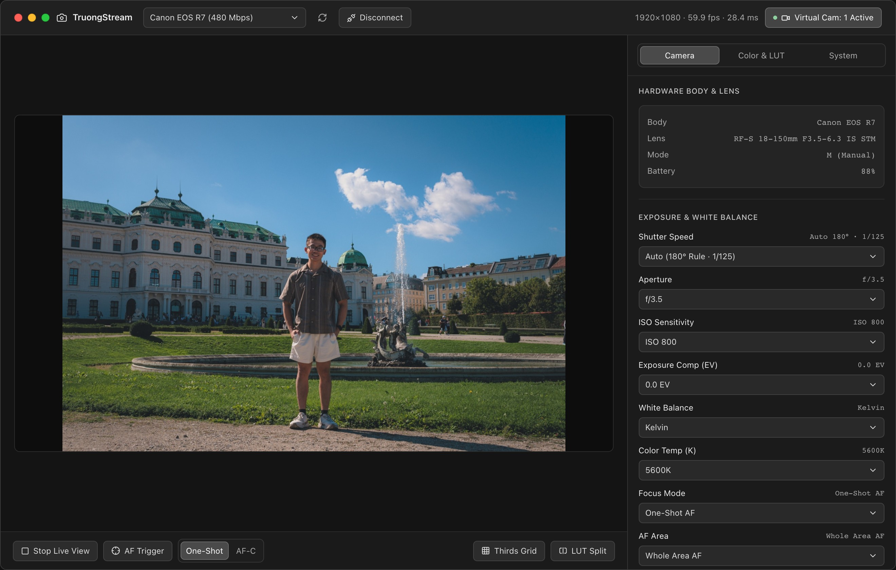
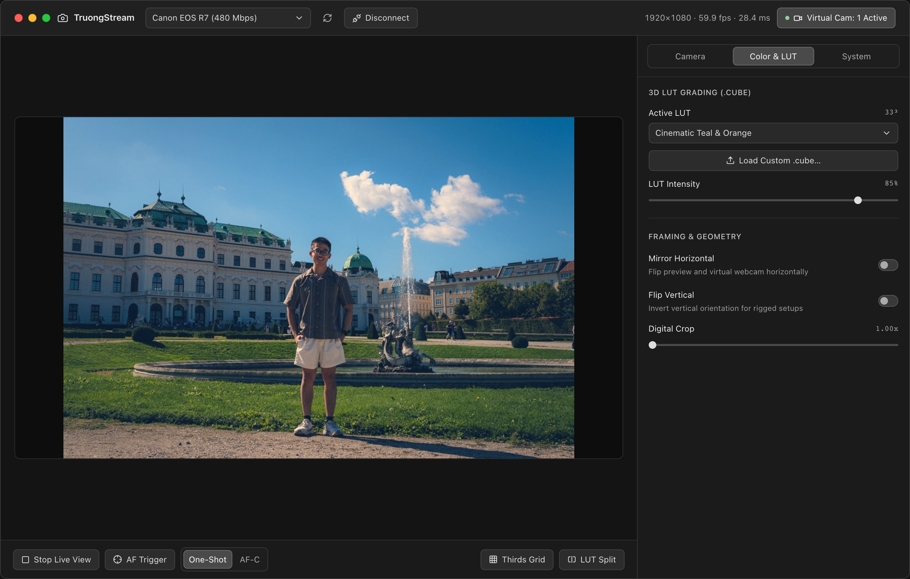
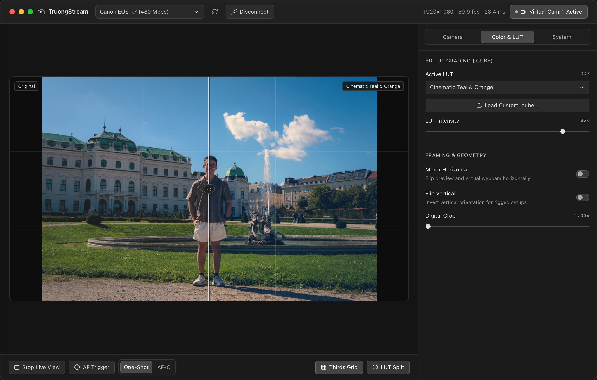
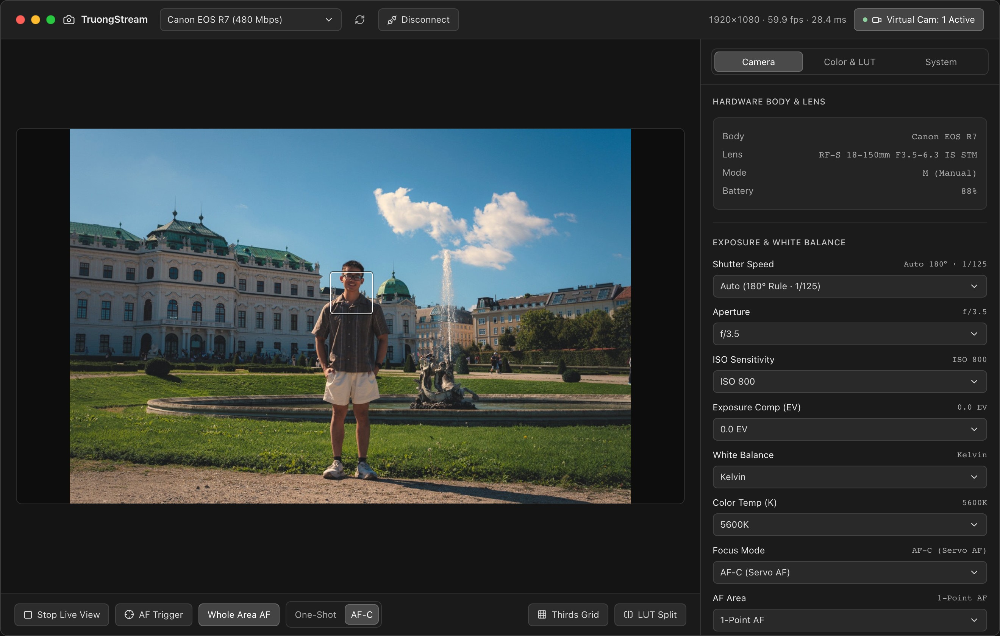
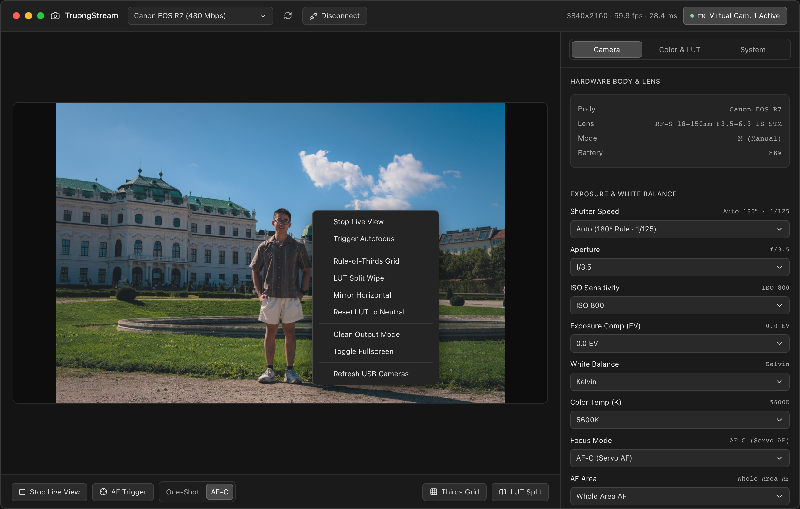

<div align="center">


# TruongStream

A zero-configuration cross-platform webcam studio for macOS and Windows built in Rust, Metal, and Direct3D 11 that streams Canon, Sony, Nikon, and Fujifilm cameras over USB or uncompressed 1080p/4K HDMI with live `.cube` 3D LUT color grading.

[Download for macOS](https://github.com/iant4093/TruongStream/releases/latest/download/TruongStream-macOS.dmg) · [Download for Windows](https://github.com/iant4093/TruongStream/releases/latest/download/TruongStream-Windows-Setup.exe) · [Releases](https://github.com/iant4093/TruongStream/releases) · [Build status](https://github.com/iant4093/TruongStream/actions) · [Report an issue](https://github.com/iant4093/TruongStream/issues)

[](https://github.com/iant4093/TruongStream/releases/latest/download/TruongStream-macOS.dmg)
[](https://github.com/iant4093/TruongStream/releases/latest/download/TruongStream-Windows-Setup.exe)


_%7C_Windows_x64-555555)
[](https://github.com/iant4093/TruongStream/actions/workflows/ci.yml)

</div>

---

TruongStream turns interchangeable-lens cameras from Canon, Sony, Nikon, and Fujifilm into studio-graded webcams and local video sources on macOS and Windows. Connect over standard USB PTP for driverless Live View and two-way hardware exposure, white balance, and autofocus controls, or ingest uncompressed 1080p and 4K HDMI capture feeds directly through native GPU 3D LUT compute shaders without JPEG roundtrips.

Every camera session runs on a dedicated single-threaded half-duplex worker that serializes live frames, event polling, and UI property changes into a drop-oldest mailbox ring buffer, feeding single-pass Metal (`IOSurface`) and Direct3D 11 (`DXGI` / DirectCompute) `.cube` grading alongside an always-on local MJPEG loopback stream and native OS virtual camera sinks—all inside a neutral dark studio interface matching [TruongPaper](https://github.com/iant4093/TruongPaper).

## Screenshots

Screenshots show the Studio UI in the browser preview (`Canon EOS R7` USB PTP session with `Cam Link 4K` paired for HDMI), using a featured photo from [day-3-vienna](https://iantruongphotography.com/album/day-3-vienna) on [iantruongphotography.com](https://iantruongphotography.com) graded with TruongStream's built-in 3D LUT engine.

<table>
  <tr>
    <td width="50%" valign="top">
      
      <p align="center"><sub><b>Camera Controls</b> · dynamic body/lens descriptors, 180° shutter rule and two-way dials</sub></p>
    </td>
    <td width="50%" valign="top">
      
      <p align="center"><sub><b>3D LUT Color Grading</b> · 10 bundled GPU presets, custom .cube loader and framing transforms</sub></p>
    </td>
  </tr>
  <tr>
    <td width="50%" valign="top">
      
      <p align="center"><sub><b>Before / After Split Wipe</b> · draggable on-canvas LUT comparison and rule-of-thirds overlay</sub></p>
    </td>
    <td width="50%" valign="top">
      
      <p align="center"><sub><b>Tap-to-Focus & AF-C</b> · click-to-focus coordinate reticle with Whole Area AF unlock</sub></p>
    </td>
  </tr>
  <tr>
    <td width="50%" valign="top">
      
      <p align="center"><sub><b>Uncompressed HDMI & Virtual Cam</b> · 4K HDMI capture, hybrid USB+HDMI mode and GPU diagnostics</sub></p>
    </td>
    <td width="50%" valign="top">
      
      <p align="center"><sub><b>Studio Context Menu</b> · native right-click menu with Clean Output Mode and quick toggles</sub></p>
    </td>
  </tr>
</table>

## Features

**USB PTP Engine & Hardware Camera Control**

- Single dedicated half-duplex USB worker thread per camera: strictly serializes `next_frame()`, `poll_events()`, and queued `set_property()` commands so dial edits never collide on PTP bulk pipes
- Dynamic capability discovery: parses camera availability tables (`0xC18A` on Canon, `SDIO_GetAllExtDevicePropInfo` on Sony, `GetDevicePropDesc` on Nikon/Fujifilm) on connect without hardcoding shutter speeds, apertures, or ISOs
- Two-way physical dial sync: turning an ISO, shutter, or aperture dial on the camera body updates the Studio UI in real time, with Manual (`M`) dial validation
- `Auto (180° Rule)` shutter speed mode (`1/60` at 30 FPS, `1/125` at 60 FPS), tap-to-focus coordinate mapping with `1-Point AF`, `One-Shot` / `AF-C` switching, manual focus step nudges, and one-click reset back to `Whole Area AF`
- OS conflict handling: detects competing `ptpcamerad` / `mscamerad-xpc` locks on macOS and builds native Windows WPD (`IPortableDevice`) + PTP support so users never need Zadig driver replacement

**Uncompressed 1080p / 4K HDMI & Hybrid Mode**

- Native uncompressed capture ingestion via `AVFoundation` on macOS (`TS_MACOS_HDMI`) and `Media Foundation` (`IMFSourceReader` with `MF_SOURCE_READER_ENABLE_VIDEO_PROCESSING`) on Windows
- Supports standalone capture-card operation (`Elgato Cam Link 4K`, `HD60 X`, `Magewell`, `Blackmagic`, generic USB 3.0 UVC HDMI) as well as **Hybrid USB PTP + HDMI** mode: pair any HDMI capture device under **System › Video Input Source** to get full uncompressed `1920×1080` or `3840×2160` video while USB PTP continues controlling camera dials and autofocus
- Passes uncompressed `BGRA8` / `YUY2` / `NV12` frames directly into the Metal (`ts_macos_pipeline_process_bgra`) and Direct3D 11 (`ts_win_pipeline_process_bgra`) 3D LUT compute shaders without JPEG recompression

**Zero-Copy GPU 3D LUT Pipeline & 10 Bundled Presets**

- Lock-free drop-oldest SPSC mailbox ring buffer (`ring_buffer.rs`), `.cube` parser (`17³`, `33³`, `65³` grids), and custom `.cube` file import
- 10 prepackaged GPU presets: `Neutral (Bypass)`, `Rec.709 Crisp`, `Cinematic Teal & Orange`, `Warm Kodak 2383`, `Fujifilm Eterna Cinema`, `Classic Chrome Documentary`, `S-Cinetone Natural Skin`, `Golden Hour Amber`, `Silver Bleach Bypass`, and `Monochrome Acros`
- Single-pass Metal (`LutPipeline.metal`) and HLSL `cs_5_0` (`LutPipeline.hlsl`) compute shaders performing aspect-fit scaling, 5-tap Contrast-Adaptive Sharpening (CAS) when upscaling USB EVF feeds, trilinear 3D LUT blending, mirror/flip/digital crop, and BT.709 limited-range NV12 output

**OS Virtual Camera Sinks, Local MJPEG Stream & Studio UI**

- **macOS (`CMIOExtension`) & Local MJPEG Loopback**: CoreMediaIO virtual camera sink (`IOSurface`) alongside an always-on local HTTP loopback server (`http://127.0.0.1:49210/stream.mjpeg` & `/frame.jpg`) and borderless **Clean Output Mode** (`Esc` to exit) for OBS, browsers, and ad-hoc local builds
- **Windows (`MFCreateVirtualCamera` & Direct3D 11)**: Native C++ Direct3D 11 + HLSL DirectCompute (`D3DCompile`, hardware + WARP fallback), Media Foundation HDMI capture, dynamic `mfsensorgroup.dll` loading (`Windows 10/11` safe), and WPD probing
- **Studio UI & Auto-Updater**: Neutral dark theme matching `TruongPaper`, native macOS fullscreen and hover traffic-light glyphs, custom right-click context menu, draggable before/after LUT split wipe, auto-sleep sensor protection, and signed GitHub Releases auto-updates under **System › Updates**

| Brand / Source | Interface & Protocol | Key Models | Status |
|---|---|---|---|
| **Canon** | USB `0x04A9` EOS PTP (`0x9115`, `0x9114`, `0x9116`, `0x9110`, `0x9153`, `0x9154`, `0x9160`) | EOS R7, R5, R6 II, R8, R10, 5D/6D/90D | **Live Verified (EOS R7 `0x32F7`)** |
| **Sony** | USB `0x054C` PC Remote SDIO (`0x9201`–`0x9209`, `0x1009`) | a7 IV, a7S III, a7R V, a7C II, a6700, ZV-E1, FX3/FX30 | Protocol Implemented |
| **Nikon** | USB `0x04B0` Nikon PTP (`0x9201`–`0x9205`, `0x90C1`, `0x90C7`) | Z9, Z8, Z6 III, Z6 II, Z7 II, Zf, Zfc, D850 | Protocol Implemented |
| **Fujifilm** | USB `0x04CB` Fuji Tether (`0x1009`, `0x1015`, `0x1016`, `0xD001`) | X-T5, X-H2S, X-H2, X-S20, X-T4, GFX100 II | Protocol Implemented |
| **HDMI Capture** | Native `AVFoundation` (macOS) / `Media Foundation` `IMFSourceReader` (Windows) | Cam Link 4K, HD60 X, Magewell, Blackmagic, UVC HDMI | **Uncompressed 1080p / 4K + Hybrid PTP** |

## Install

Download the latest installers from [GitHub Releases](https://github.com/iant4093/TruongStream/releases/latest). Installed apps update themselves from there.

**macOS** (Apple Silicon, macOS 14.2 or later)

1. Download [TruongStream-macOS.dmg](https://github.com/iant4093/TruongStream/releases/latest/download/TruongStream-macOS.dmg) and drag TruongStream into Applications.
2. Open TruongStream. macOS will say it can't verify the developer, because release builds are ad-hoc signed rather than notarized. Click **Done**, then go to **System Settings › Privacy & Security**, scroll down to the message about TruongStream and click **Open Anyway**, then confirm with your password. You only need to do this once.
3. For OBS or browser capture without an Apple Developer ID notarized system extension, use the built-in **Local MJPEG Stream** (`http://127.0.0.1:49210/stream.mjpeg`) or **Clean Output Mode** (`Esc` to exit) under **System › Virtual Camera Output**.

**Windows** (x64, Windows 10 1809 or later / Windows 11)

1. Download [TruongStream-Windows-Setup.exe](https://github.com/iant4093/TruongStream/releases/latest/download/TruongStream-Windows-Setup.exe) and run it.
2. If SmartScreen appears, choose **More info › Run anyway**. The installer is not code-signed.
3. Connect your camera via USB (in standard MTP/PTP mode—no Zadig driver replacement needed) and/or plug in an HDMI capture card.

Installed copies check GitHub Releases from **System › Updates**, display release notes, and install updates cleanly after closing active camera sessions and verifying the Minisign signature.

## Tech stack

| Area | Technologies |
|---|---|
| App shell | Tauri 2 (Rust), WKWebView on macOS, WebView2 on Windows |
| Interface | React 19, TypeScript, Vite, Zustand, lucide-react, `TruongPaper` neutral dark theme |
| Core PTP & HDMI Engine | Rust (`rusb` / `libusb-1.0`, WPD `IPortableDevice`), `AVFoundation` (macOS) & `Media Foundation` `IMFSourceReader` (Windows), lock-free SPSC mailbox ring buffer |
| GPU Media Pipeline | macOS `VideoToolbox` + `Metal` Compute (`MTLTextureType3D` + `IOSurface`), Windows native C++ `D3D11` + `HLSL` DirectCompute (`cs_5_0`) + `DXGI` |
| Virtual Camera & Output | macOS `CoreMediaIO` (`CMIOExtension`), Windows `MFCreateVirtualCamera`, local HTTP MJPEG loopback (`127.0.0.1:49210`) |
| Delivery | GitHub Actions, macOS `.dmg`, Windows NSIS installer, signed auto-updates, SHA-256 checksums |

## Build locally

Requires **Node 22.12+**, **Rust 1.82+** (CI builds with 1.94.0), `libusb` (`brew install libusb` on macOS), and the [Tauri prerequisites](https://v2.tauri.app/start/prerequisites/) for your platform.

```bash
cd app-ui
npm install

# Desktop app with hot reload
npm run app:dev

# UI-only preview in a browser with simulated controls and photo preview
npm run dev

# Production desktop installer build
npx tauri build
```

## Tests

```bash
# Rust formatting, strict clippy lints, and workspace unit tests
cargo fmt --all -- --check
cargo clippy --workspace --all-targets --locked -- -D warnings
cargo test --workspace --locked

# Live Canon EOS R7 USB hardware proof-of-concept (connect EOS R7 over USB first)
cargo run -p truongstream-core --example eos_r7_probe

# End-to-end Canon EOS R7 + VideoToolbox + Metal 3D LUT + IOSurface benchmark (macOS)
cargo run -p truongstream-macos --example eos_r7_metal_benchmark

# Frontend unit/component tests (Vitest) and TypeScript/Vite build
cd app-ui
npm test
npm run build
```

## CI and releases

Pull requests and pushes to `main` run:

1. Vitest unit/component tests, TypeScript checks, and production frontend build (`app-ui/`).
2. `cargo fmt`, `cargo clippy --workspace --all-targets --locked -- -D warnings`, `cargo test --workspace --locked`, and Tauri installer builds on macOS (`.dmg`) and Windows (native C++ MSVC + NSIS `.exe`).

Pushes to `main` produce test installers in the Actions artifacts. Manually running **CI** on `main` with **publish** enabled publishes a GitHub Release `v<major>.<minor>.<run number>` containing `TruongStream-macOS.dmg`, `TruongStream-Windows-Setup.exe`, `TruongStream-macOS.app.tar.gz`, `latest.json`, and `SHA256SUMS`.

The updater signing key is stored as the `TAURI_SIGNING_PRIVATE_KEY` repository secret. GitHub Actions are pinned to commit SHAs, and Dependabot checks them weekly.

## Repository layout

```text
.
├── core/                         Platform-agnostic Rust PTP, HDMI & 3D LUT core
│   ├── examples/                 Live hardware probes (eos_r7_probe.rs)
│   └── src/
│       ├── ptp/                  Base PTP USB packet framing & macOS daemon guard
│       ├── drivers/              CameraDriver trait + canon.rs, sony.rs, nikon.rs, fujifilm.rs, hdmi.rs
│       ├── lut/                  .cube 3D LUT parser, 10 presets & trilinear sampler
│       └── ring_buffer.rs        Lock-free SPSC drop-oldest mailbox ring buffer
├── platform-macos/               macOS native GPU, AVFoundation HDMI & CoreMediaIO sink
│   ├── VideoPipeline/            VideoToolbox/AVFoundation HDMI + Metal 3D LUT NV12 compute shader
│   └── VirtualCamExtension/      CMIOExtension system extension (IOSurface sink)
├── platform-windows/             Windows native WPD, D3D11 & Media Foundation layer
│   ├── Transport/                WPD (IPortableDevice) raw PTP pass-through
│   ├── VideoPipeline/            D3D11 DirectCompute + HLSL 3D LUT shader + MfHdmiCapture.cpp
│   └── VirtualCamSink/           MFCreateVirtualCamera (dynamic mfsensorgroup loader)
├── app-ui/                       Tauri + React + TypeScript Studio UI
│   ├── public/preview/           LUT-graded studio preview photographs for browser dev mode
│   ├── src/
│   │   ├── components/           TopBar, LiveViewport, RightInspector, Dropdown, ContextMenu, WindowControls
│   │   ├── services/             Signed GitHub Releases auto-updater (updates.ts)
│   │   ├── styles/               Design tokens & components (tokens.css)
│   │   └── state/                Zustand synced camera, LUT & telemetry store
│   ├── tests/                    Vitest frontend & UI tests
│   └── src-tauri/                Tauri v2 commands, Info.plist & core session bridge
├── docs/                         App icon and README screenshots (screenshots/)
├── .github/                      CI/release workflow and Dependabot
└── README.md                     Sole repository documentation
```

TruongStream is an independent project and is not affiliated with or endorsed by Canon, Sony, Nikon, or Fujifilm.
